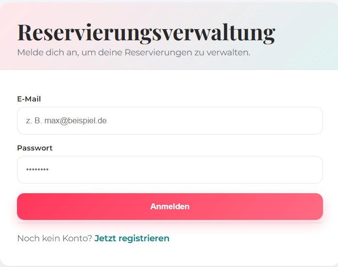
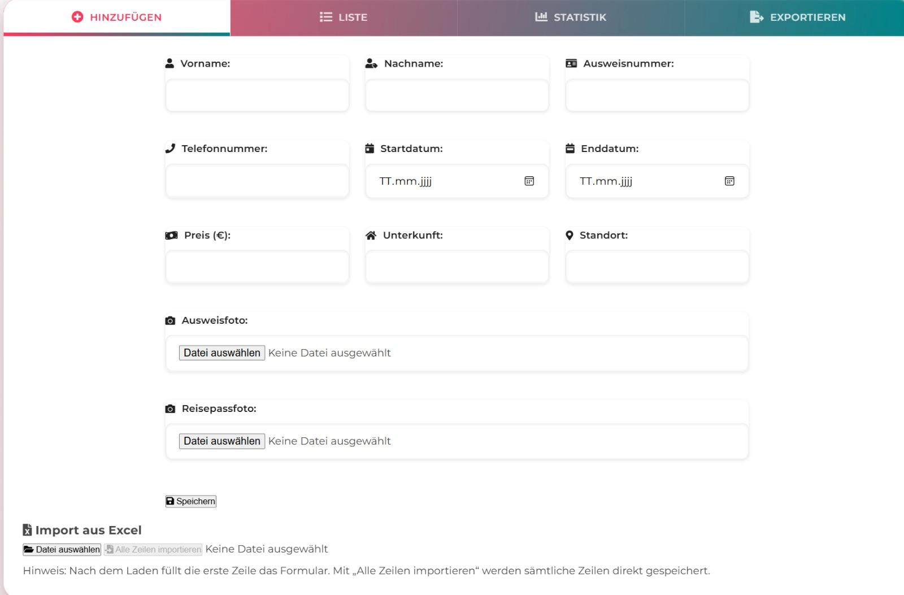
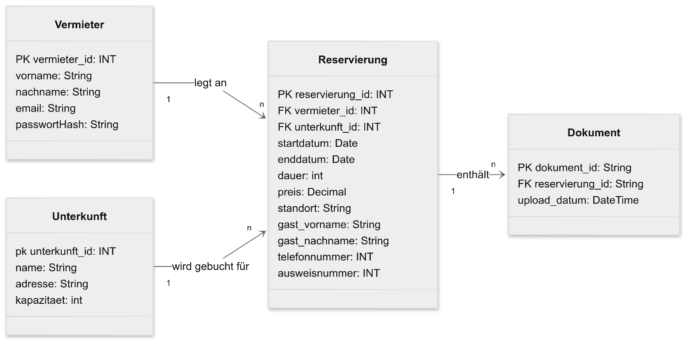

# 🏠 Immobilien- und Reservierungsverwaltung

> **Wirtschaftsinformatik – Projekt 1 | Technische Hochschule Mittelhessen (THM)**  
> Akademisches **Gruppenprojekt** zur Entwicklung einer webbasierten Reservierungsverwaltung.

## 🎯 Projektübersicht

Diese Webanwendung ist ein lokaler Prototyp für die zentrale Verwaltung von Unterkünften und Reservierungen. Vermieterinnen und Vermieter können sich registrieren, anmelden, Reservierungen erfassen und eine Übersicht mit Kennzahlen und Exportmöglichkeiten nutzen.

Im Repository befinden sich der **tatsächliche Projekt-Quellcode** (Frontend und Backend) sowie ausgewählte, nicht personenbezogene **UI-Entwürfe aus der Projektspezifikation** (keine Live-Screenshots).

## 🏗️ Architektur

```text
Browser (Frontend: HTML, CSS, JavaScript)
   |    Registrierung, Login, Reservierungen, Statistiken
   |    HTTP / JSON
   v
Node.js + Express (REST-API, Port 4000)
   |-- Authentifizierung: JWT + bcryptjs
   |-- Reservierungs-Endpoints (Nutzerzuordnung)
   |-- Unterkunfts-Endpoints
   v
LowDB (lokal: backend/db.json, nicht auf GitHub)
   |-- users
   |-- unterkuenfte
   `-- reservierungen
```

Das Architektur-Dokument beschreibt eine dreischichtige Lösung. **Die im Archiv vorhandene Implementierung verwendet LowDB mit lokaler JSON-Datei**, nicht PostgreSQL/MySQL. Eine externe Datenbank wäre eine spätere Weiterentwicklung.

## 🛠️ Technologien

| Ebene | Technologie | Verwendung |
|---|---|---|
| Frontend | HTML5, CSS3, JavaScript | Benutzeroberfläche und API-Aufrufe |
| Backend | Node.js, Express | REST-API und Geschäftslogik |
| Authentifizierung | `jsonwebtoken`, `bcryptjs` | JWT und Passwort-Hashing |
| Datenspeicherung | LowDB | Lokale JSON-Datei für den Prototyp |
| Import | SheetJS (`xlsx`, CDN) | Import von Excel-Daten im Browser |
| Export | jsPDF, jsPDF-AutoTable (CDN) | PDF-Ausgabe im Browser |
| Entwicklung | VS Code, Git | Quellcode und Versionsverwaltung |

## ✨ Im Quellcode erkennbare Funktionen

- ✅ Registrierung und Anmeldung mit Passwort-Hashing und JWT.
- ✅ Formular für Reservierungen mit Datumsprüfung und Preisangabe.
- ✅ Reservierungsübersicht und Löschen eigener Reservierungen.
- ✅ REST-API mit benutzerbezogener Abfrage von Reservierungen.
- ✅ Excel-Einleseprozess im Frontend und PDF-Exportfunktionen.
- ✅ Anzeige von Monats-/Jahressummen und Unterkunftszahl.
- ✅ Unterkunfts-API im Backend (Lesen, Anlegen, Bearbeiten, Löschen).

**Einordnung:** Das ist ein **Studienprototyp**. Nicht jede im Spezifikationsdokument genannte Funktion ist in den mitgelieferten Dateien vollständig oder sicher für den Produktiveinsatz umgesetzt. Beispielsweise verwendet das Frontend für Bildanhänge Data-URLs, die im JSON-Datenbestand landen können. Keine echten Ausweis- oder Gästedaten zum Testen nutzen.

## 📊 Datenmodell (Prototyp)

```text
users                 unterkuenfte
  |                         |
  | 1                     1|
  |                         |
  +----< reservierungen >---+
              |
              +-- Angaben zu Gast, Zeitraum, Preis,
                  Unterkunft und ggf. Bildanhängen
```

Die ursprünglichen Projektunterlagen dokumentieren außerdem das fachliche Modell **Vermieter – Unterkunft – Reservierung – Dokument**. Die Programmimplementierung speichert derzeit die Nutzer, Unterkünfte und Reservierungen in LowDB und führt Anhänge nicht als eigenständige Tabelle.

## 🚀 Projektablauf

1. Anforderungen, Systemgrenzen und Use Cases erarbeitet.
2. Fachliches Datenmodell und UI-Entwürfe erstellt.
3. Frontend für Anmeldung, Registrierung und Reservierungsverwaltung entwickelt.
4. Node.js-/Express-Backend mit REST-Endpunkten aufgebaut.
5. Anmeldung und benutzerbezogene Reservierungen über JWT realisiert.
6. Auswertungs-, Import- und Exportfunktionen im Frontend ergänzt.
7. Architektur und technische Entscheidungen dokumentiert.

## 📸 Screenshots und Diagramme

**UI-Entwurf: Login aus der Spezifikation**



**UI-Entwurf: Reservierung erfassen aus der Spezifikation**



**UI-Entwurf: Statistiken aus der Spezifikation**


**Konzeptionelles Datenmodell aus der Spezifikation**



## 📁 Repository-Struktur

```text
projekt1-immobilien-reservierungsverwaltung/
├── README.md
├── .gitignore
├── frontend/
│   ├── index.html
│   ├── login.html
│   ├── register.html
│   ├── renderer.js
│   └── style.css
├── backend/
│   ├── server.js
│   ├── package.json
│   ├── package-lock.json
│   ├── db.example.json
│   └── .env.example
├── docs/
│   ├── architecture.md
│   ├── requirements.md
│   ├── setup.md
│   └── publishing-checklist.md
└── screenshots/
    ├── login-page.png
    ├── reservation-form.png
    ├── statistics-page.png
    └── data-model-concept.png
```

## ▶️ Lokal starten

Benötigt: **Node.js und npm**, sowie zum Anzeigen der HTML-Seiten einen lokalen Webserver (z. B. Python). Die Weboberfläche nutzt außerdem externe Bibliotheken per CDN.

1. Im Projektordner das Terminal öffnen und ins Backend wechseln:

   ```powershell
   cd backend
   Copy-Item db.example.json db.json
   npm ci
   $env:JWT_SECRET = "HIER_EIN_EIGENES_LANGES_ZUFAELLIGES_GEHEIMNIS_EINSETZEN"
   npm start
   ```

2. In einem **zweiten Terminal** den Frontend-Webserver starten (Python muss installiert sein):

   ```powershell
   cd frontend
   python -m http.server 5500
   ```

3. Im Browser **http://127.0.0.1:5500/register.html** öffnen und nur erfundene Testdaten verwenden.

Bei `cd frontend` startest du aus dem **Hauptverzeichnis** des Projekts, nicht aus `backend`. Ausführlichere Hinweise: [docs/setup.md](docs/setup.md).

## 🔒 Sicherheit und Veröffentlichungsstatus

- Die Originaldatei `backend/db.json` ist **absichtlich nicht enthalten**, da sie Benutzer-/Reservierungsdaten und Passwort-Hashes enthält.
- Das Projekt verwendet einen **JWT-Schlüssel aus der Umgebungsvariable**; der Demo-Standardwert aus dem Originalcode wurde entfernt.
- Im veröffentlichten Backend wird bei neuen Reservierungen die Benutzer-ID nicht mehr aus dem Request übernommen.
- `node_modules` wird nicht hochgeladen; Abhängigkeiten werden mit `npm ci` installiert.
- **Nicht als sicherheitsgeprüfte Produktivsoftware verwenden.** Der Prototyp braucht weitere Überprüfungen, insbesondere für Zugriffskontrolle bei Unterkünften, Eingabevalidierung, Datei-Uploads, Cross-Origin-Konfiguration und Browser-Darstellung von Daten.
- Prüfe vor der Veröffentlichung die **Zustimmung des Projektteams** und die Rechte an den gemeinsam erstellten Dateien.

## 👥 Projektkontext

Entstanden als **Gruppenarbeit im Bachelorstudiengang Wirtschaftsinformatik an der THM**, Modul *Wirtschaftsinformatik – Projekt 1*.

Dieses Repository dokumentiert die Gruppenlösung; es erhebt **keinen Anspruch, dass eine Einzelperson sämtliche Komponenten allein entwickelt hat**.
