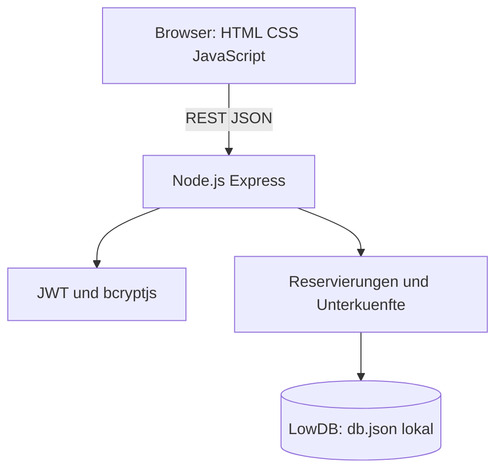

# Architektur (Projekt 1)

Das im Projekt erarbeitete Architekturkonzept folgt drei Schichten:

1. **Präsentation:** HTML/CSS/JavaScript, Login, Registrierung, Reservierungsformular und Übersichten.
2. **Anwendungslogik:** Express-API, Passwort-Hashing mit bcryptjs, JWT, CRUD-Endpunkte.
3. **Persistenz:** LowDB mit einer lokalen `backend/db.json`-Datei.

**Konzept vs. Implementierung:** In den Dokumenten wird als spätere Option eine relationale SQL-Datenbank erwähnt. Der bereitgestellte Code implementiert jedoch LowDB. Die hochgeladenen Originaldokumente werden hier nicht vollständig reproduziert.

## Einschränkungen des Prototyps

- Keine produktive Mandantentrennung für alle Unterkunfts-Operationen nachgewiesen.
- Im Frontend werden Datensätze teilweise über `innerHTML` in die Tabelle eingefügt; vor echtem Betrieb gegen XSS absichern.
- Bilddaten können als Data-URLs im JSON-Datenbestand landen; keine echte sichere Dateispeicherung oder Verschlüsselung nachgewiesen.
- HTTP und permissive CORS-Einstellungen sind für einen lokalen Prototyp gedacht, nicht für ein öffentliches Deployment.
